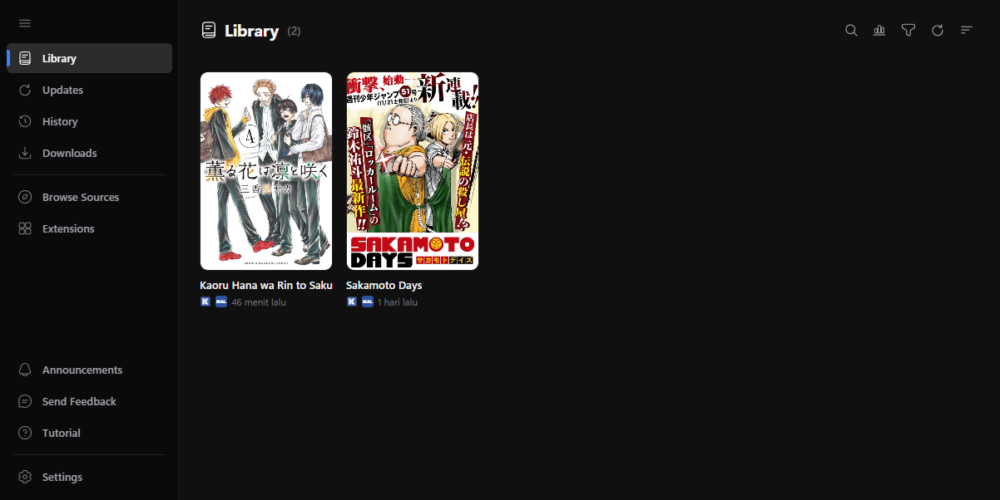
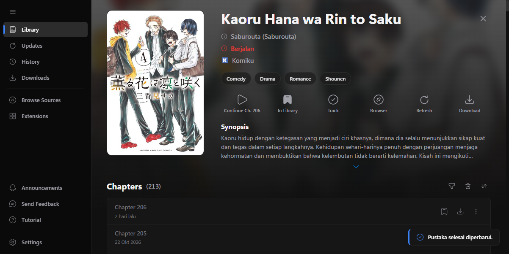
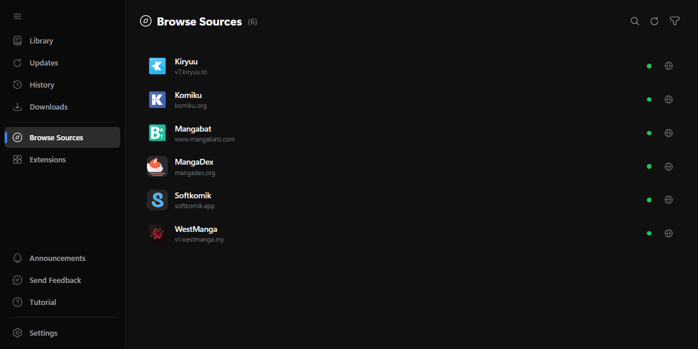
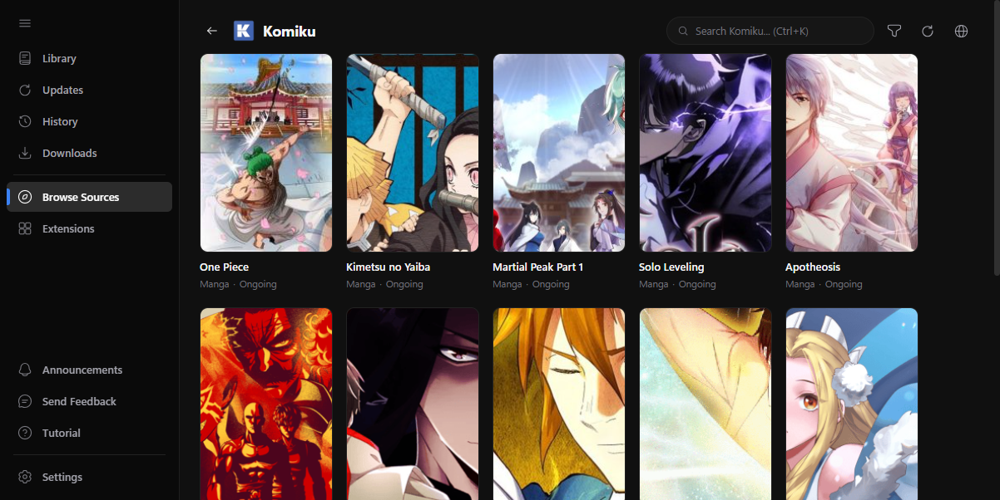
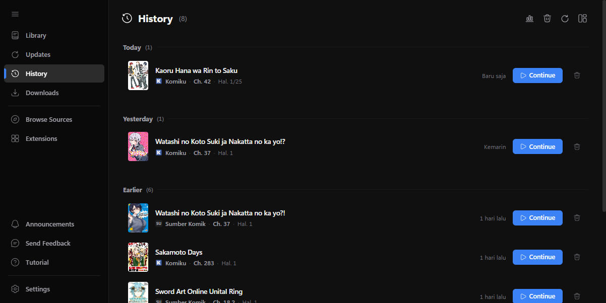
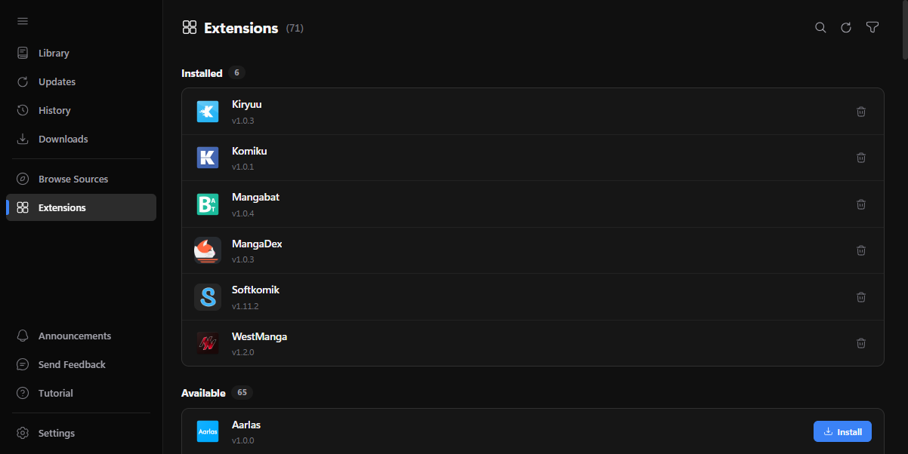
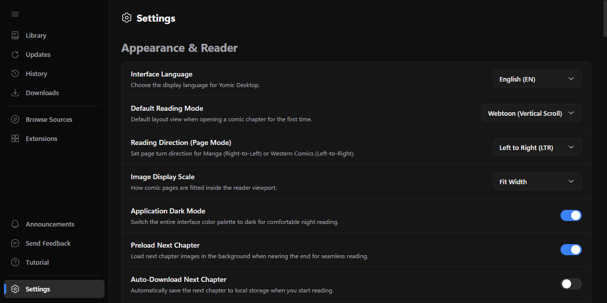

<div align="center">


<br/>


<br/><br/>

[](./LICENSE)
[-0078D4.svg?style=flat-square&logo=windows)](https://github.com/ArisaAkiyama/yomic)
[](https://dotnet.microsoft.com/)
[](https://developer.microsoft.com/en-us/microsoft-edge/webview2/)
[](https://github.com/ArisaAkiyama/extension-yomic)
[](https://github.com/ArisaAkiyama/yomic/releases/latest)
[](https://github.com/ArisaAkiyama/yomic/releases)
[](https://github.com/ArisaAkiyama/yomic/stargazers)
[](https://github.com/ArisaAkiyama/yomic-android)

<br/>

### 🌐 Bahasa / Language

[](./README.md)
[-22C55E?style=for-the-badge)](./README.id.md)

<br/>

<p align="center">
  <b>Yomic v2</b> adalah aplikasi desktop Windows modern dan <i>open-source</i> untuk membaca manga, manhwa, manhua, dan webtoon.<br/>
  Ditenagai arsitektur hibrida <b>.NET 8 WPF + WebView2 + TypeScript</b> tanpa iklan, dengan unduhan offline (folder &amp; <code>.cbz</code>) serta 102+ ekstensi JS modular.
</p>

<br/>

<table>
  <tr>
    <td align="center" width="240">
      <b>📥 Unduh Installer (PC)</b><br/><br/>
      <a href="https://github.com/ArisaAkiyama/yomic/releases/latest">
        
      </a>
    </td>
    <td align="center" width="240">
      <b>📱 Yomic Mobile (Android)</b><br/><br/>
      <a href="https://github.com/ArisaAkiyama/yomic-android">
        
      </a>
    </td>
    <td align="center" width="240">
      <b>☕ Dukungan &amp; Donasi</b><br/><br/>
      <a href="https://trakteer.id/Arisa-Akiyama" target="_blank">
        
      </a>
    </td>
  </tr>
</table>

<p align="center">
  <b>Jika Anda menyukai Yomic, jangan lupa berikan ⭐ pada repositori ini!</b>
</p>

</div>

---

## 📖 Daftar Isi

- [Ringkasan](#-ringkasan)
- [Tangkapan Layar](#-tangkapan-layar)
- [Fitur Utama](#-fitur-utama)
- [Arsitektur](#️-arsitektur)
- [Instalasi & Upgrade dari v1](#-instalasi--upgrade-dari-v1)
- [Build dari Source Code](#️-build-dari-source-code)
- [Struktur Proyek](#-struktur-proyek)
- [Pintasan Papan Ketik](#️-pintasan-papan-ketik)
- [Penafian (Disclaimer)](#️-penafian-disclaimer)
- [Lisensi](#-lisensi)

---

## 🔍 Ringkasan

**Yomic v2** menyatukan penjelajahan katalog komik, manajemen pustaka, pembacaan offline, dan pelacakan progres bacaan ke dalam pengalaman aplikasi desktop yang cepat dan bebas gangguan iklan. Yomic terhubung ke 102+ sumber komik melalui ekstensi JavaScript ringan (`Jint` + `AngleSharp`) serta me-render halaman menggunakan **WebView2** berakselerasi perangkat keras dan pemrosesan gambar **SkiaSharp**.

---

## 📸 Tangkapan Layar

<table>
  <tr>
    <td align="center" width="50%">
      <b>Pustaka (Library)</b><br/><br/>
      
    </td>
    <td align="center" width="50%">
      <b>Detail Komik &amp; Daftar Bab</b><br/><br/>
      
    </td>
  </tr>
  <tr>
    <td align="center" width="50%">
      <b>Pembaca Imersif</b><br/><br/>
      
    </td>
    <td align="center" width="50%">
      <b>Jelajahi Sumber</b><br/><br/>
      
    </td>
  </tr>
  <tr>
    <td align="center" width="50%">
      <b>Katalog Sumber</b><br/><br/>
      
    </td>
    <td align="center" width="50%">
      <b>Riwayat Bacaan</b><br/><br/>
      
    </td>
  </tr>
  <tr>
    <td align="center" width="50%">
      <b>Manajer Ekstensi</b><br/><br/>
      
    </td>
    <td align="center" width="50%">
      <b>Pengaturan</b><br/><br/>
      
    </td>
  </tr>
</table>

---

## ✨ Fitur Utama

### 🎨 Antarmuka Hibrida Modern & Tema
- **Tema Ocean Light, Carbon Dark & Deep-Ocean Reader Dark** yang tersinkronisasi dengan bingkai jendela native Windows 10/11 (`dwmapi`).
- **Antarmuka Dua Bahasa (Indonesia & Inggris)** dengan pergantian instan tanpa restart.
- **Single-Instance Guard** (`Local\Yomic_SingleInstance_Mutex`) dan sinkronisasi pustaka latar belakang tanpa jendela (`--background-update`).

### 📖 Pembaca Berperforma Tinggi & Mesin Gambar SkiaSharp
- **Mode Baca Webtoon, Halaman Tunggal, dan Dua Halaman** dengan arah baca `LTR` / `RTL`, preset zoom, *auto-scroll*, dan pintasan keyboard yang dapat disesuaikan.
- **Pemrosesan Gambar SkiaSharp** melalui proxy internal `https://img.yomic.local/*`: pemotongan pinggiran putih/hitam otomatis (*auto-crop*), *smart downscaling*, penajaman *unsharp-mask*, dan optimasi WebP.
- **Penyimpanan Progres Presisi**: menyimpan persentase gulir Webtoon maupun nomor halaman secara otomatis.

### 🌐 Ketahanan Jaringan & 102+ Ekstensi
- **102+ Ekstensi JS Modular** dari [ArisaAkiyama/extension-yomic](https://github.com/ArisaAkiyama/extension-yomic) (`src/en/` & `src/id/`), lengkap dengan sakelar bahasa **ID / EN** khusus MangaDex.
- **DNS-over-HTTPS (DoH)** (Cloudflare `1.1.1.1`, Google `8.8.8.8`, AdGuard) dan **TLS ClientHello DPI Bypass** (`DpiBypassStream`).
- **Penyelesai Tantangan Cloudflare** berbasis `PuppeteerSharp` & WebView2.

### 📚 Pustaka, Statistik Membaca & Sinkronisasi
- **Dasbor Statistik Membaca**: melacak tingkat penyelesaian pustaka, estimasi waktu baca, grafik aktivitas 14 hari, genre teratas, hari aktif, dan **Daily Streak**.
- **Manajer Unduhan Offline**: antrean unduhan multi-bab dengan jeda/lanjutkan, dukungan penyimpanan arsip **`.cbz`**, unduh otomatis bab berikutnya, dan hapus otomatis setelah selesai dibaca.
- **Sinkronisasi MyAnimeList (MAL) OAuth2 PKCE**: menautkan seri komik dan menyinkronkan progres bab secara otomatis; token OAuth dienkripsi dengan **Windows DPAPI**.
- **Cadangan & Pemulihan Aman (`.yomicbackup`)**: *checkpoint* SQLite WAL otomatis sebelum pengarsipan dan kompatibel dengan **Yomic Mobile (Android)**.

---

## 🏗️ Arsitektur

```text
┌──────────────────────────────────────────────────────────────────────┐
│                        WPF Host (MainWindow)                         │
│   Custom Window Chrome • DWM Theme • Single-Instance Mutex • Tray   │
└───────────────────────────────┬──────────────────────────────────────┘
                                │  WebView2 PostMessage IPC +
                                │  https://img.yomic.local/* Proxy
┌───────────────────────────────▼──────────────────────────────────────┐
│                   WebUI (HTML / CSS / TypeScript)                    │
│   Library • Insights • Browse • Reader • Downloads • Extensions      │
└───────────────────────────────┬──────────────────────────────────────┘
                                │
┌───────────────────────────────▼──────────────────────────────────────┐
│                     .NET 8 Core Backend Services                     │
│  • BackendIpcController   • JsMangaSource (Jint + AngleSharp)        │
│  • LibraryService (SQLite WAL) • NetworkService (DoH + DPI Bypass)   │
│  • ImageProcessingService (SkiaSharp) • CloudflareBypassService      │
└──────────────────────────────────────────────────────────────────────┘
```

---

## 📦 Instalasi & Upgrade dari v1

1. Unduh **`Yomic_Setup_v2.1.0.exe`** dari halaman [GitHub Releases](https://github.com/ArisaAkiyama/yomic/releases/latest).
2. Jalankan installer — secara otomatis installer akan:
   - Menghentikan proses Yomic v1/v2 yang sedang berjalan dan menggantikan binari lama secara bersih.
   - Memasang **Microsoft Edge WebView2 Runtime** secara otomatis jika belum terpasang.
   - **Mempertahankan 100% data pengguna v1 Anda** (`%LOCALAPPDATA%\Yomic\manga.db`, `settings.json`, unduhan) serta ekstensi `.js` yang terpasang (`%APPDATA%\Yomic\Plugins\`), dan memigrasikan skema database secara otomatis saat pertama kali dijalankan.

---

## 🛠️ Build dari Source Code

### Prasyarat
- [.NET 8 SDK](https://dotnet.microsoft.com/download/dotnet/8.0) (Windows x64)
- Opsional: [Inno Setup 6](https://jrsoftware.org/isinfo.php) untuk meng-compile `Installer/Yomic.iss`

### Build & Publish
```powershell
# Clone repository
git clone https://github.com/ArisaAkiyama/yomic.git
cd yomic

# Build Release (otomatis meng-compile TypeScript WebUI melalui MSBuild)
dotnet build YomicV2.sln -c Release

# Publish distribusi mandiri win-x64
dotnet publish src\YomicDesktop\YomicDesktop.csproj -c Release -r win-x64 --self-contained true -o dist\Yomic_v2
```

---

## 📁 Struktur Proyek

```text
yomic/
├── src/YomicDesktop/
│   ├── Core/
│   │   ├── Data/               # EF Core SQLite DbContext (mode WAL)
│   │   ├── Models/             # Manga, Chapter, History, Category, Track, Announcement
│   │   ├── Services/           # Library, Download (Folder/CBZ), Network (DoH), SkiaSharp, MAL, Backup
│   │   └── Sources/            # Mesin ekstensi JS Jint & pembungkus DOM AngleSharp
│   ├── IPC/                    # Pengendali IPC WebView2, kontrak & proxy gambar
│   ├── Plugins/Catalog/        # Indeks katalog offline bawaan & 102+ skrip sumber
│   └── WebUI/                  # Frontend modular TypeScript & CSS
├── Installer/Yomic.iss         # Skrip Inno Setup 6 dengan migrasi bersih v1 -> v2
├── scripts/                    # Webhook umpan balik Google Apps Script
├── yomic-website/              # Situs web resmi proyek Yomic
├── announcements.json          # Umpan pengumuman dalam aplikasi
└── YomicV2.sln                 # Solusi Visual Studio / .NET 8
```

---

## ⌨️ Pintasan Papan Ketik

| Pintasan | Aksi |
| :--- | :--- |
| `Ctrl + K` | Fokus ke kolom pencarian pada halaman aktif |
| `Ctrl + B` | Ciutkan / perluas bilah sisi (sidebar) |
| `F11` / `F` | Mode layar penuh (fullscreen) |
| `Alt + 1..7` | Pindah antar tab navigasi utama |
| `ArrowLeft` / `ArrowRight` | Halaman atau bab Sebelumnya / Berikutnya |
| `[` / `]` | Bab Sebelumnya / Berikutnya |
| `1` / `2` / `3` | Ganti mode baca (Webtoon / Halaman Tunggal / Dua Halaman) |
| `+` / `-` / `0` | Perbesar / Perkecil / Reset zoom |
| `S` / `H` | Aktifkan *auto-scroll* / Sembunyikan HUD pembaca |

*(Seluruh pintasan dapat dikustomisasi melalui menu **Pengaturan → Pintasan Keyboard**.)*

---

## ⚠️ Penafian (Disclaimer)

Yomic tidak menyimpan, memiliki, atau mendistribusikan konten komik apa pun. Seluruh metadata dan gambar manga, manhwa, manhua, serta webtoon diambil secara langsung dari situs pihak ketiga melalui ekstensi yang dipasang oleh pengguna. Mohon dukung kreator dan penerbit resmi kapan pun memungkinkan.

---

## 📄 Lisensi

Didistribusikan di bawah **Lisensi MIT**. Lihat file [LICENSE](./LICENSE) untuk informasi selengkapnya.


