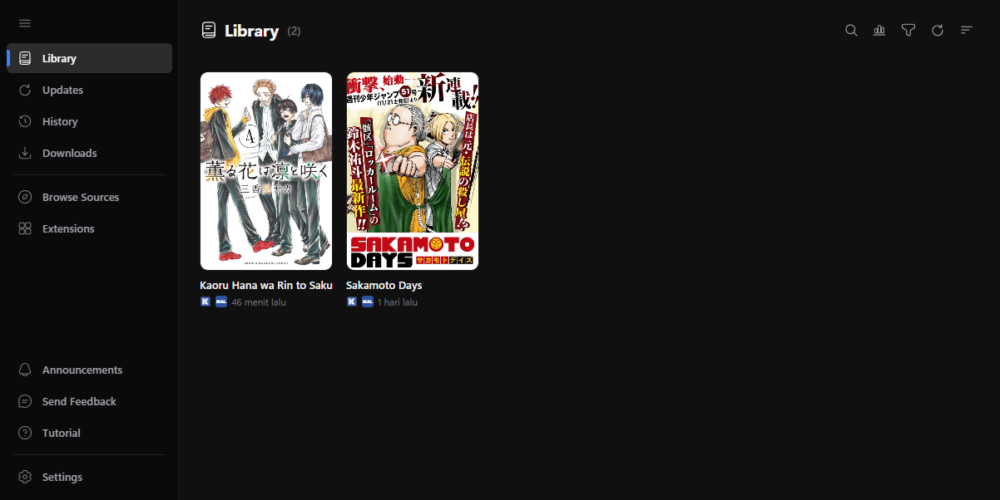
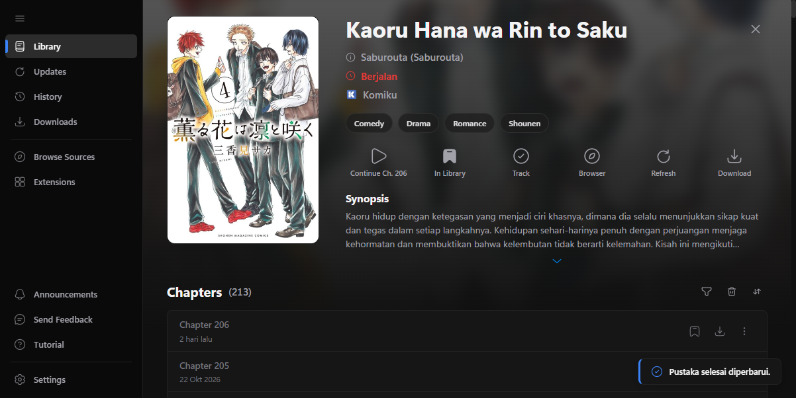
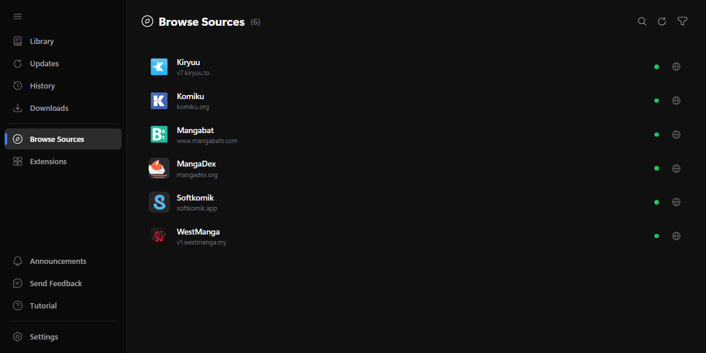
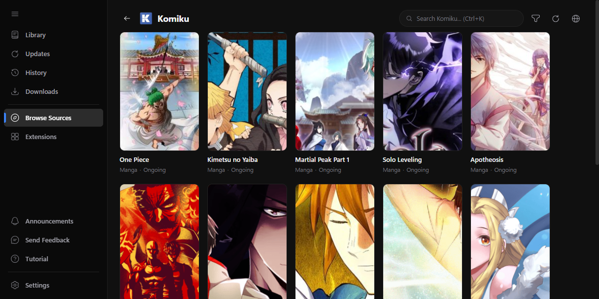
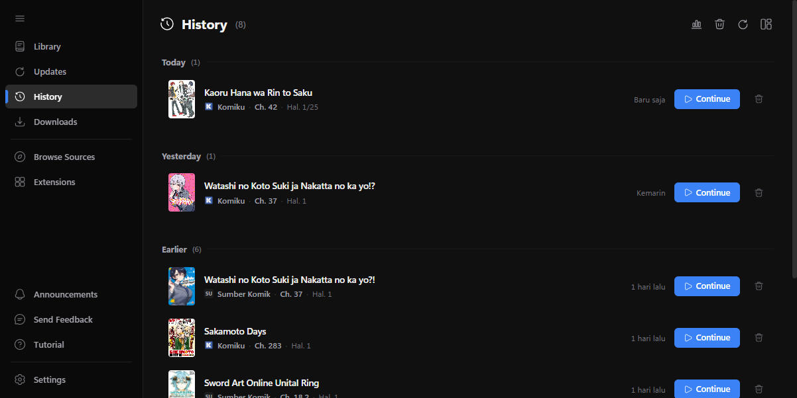
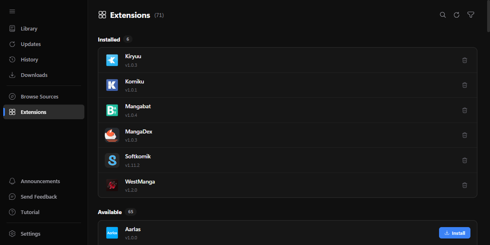
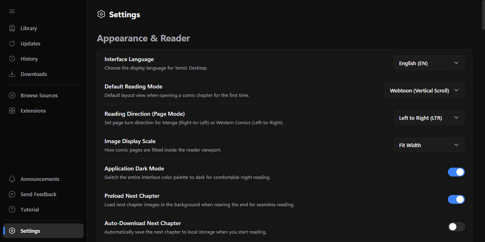

<div align="center">


<br/>


<br/><br/>

[](./LICENSE)
[-0078D4.svg?style=flat-square&logo=windows)](https://github.com/ArisaAkiyama/yomic)
[](https://dotnet.microsoft.com/)
[](https://developer.microsoft.com/en-us/microsoft-edge/webview2/)
[](https://github.com/ArisaAkiyama/extension-yomic)
[](https://github.com/ArisaAkiyama/yomic/releases/latest)
[](https://github.com/ArisaAkiyama/yomic/releases)
[](https://github.com/ArisaAkiyama/yomic/stargazers)
[](https://github.com/ArisaAkiyama/yomic-android)

<br/>

<p align="center">
  <b>Yomic v2</b> is a modern, open-source Windows desktop application for reading manga, manhwa, manhua, and webtoons.<br/>
  Powered by a hybrid <b>.NET 8 WPF + WebView2 + TypeScript</b> architecture with zero ads, offline downloads, and modular JS extensions.
</p>

<br/>

<table>
  <tr>
    <td align="center" width="240">
      <b>📥 Download Installer (PC)</b><br/><br/>
      <a href="https://github.com/ArisaAkiyama/yomic/releases/latest">
        
      </a>
    </td>
    <td align="center" width="240">
      <b>📱 Yomic Mobile (Android)</b><br/><br/>
      <a href="https://github.com/ArisaAkiyama/yomic-android">
        
      </a>
    </td>
    <td align="center" width="240">
      <b>☕ Support &amp; Donation</b><br/><br/>
      <a href="https://trakteer.id/Arisa-Akiyama" target="_blank">
        
      </a>
    </td>
  </tr>
</table>

<p align="center">
  <b>If you enjoy using Yomic, please consider giving the repository a ⭐!</b>
</p>

</div>

---

## 📖 Table of Contents

- [Overview](#-overview)
- [Screenshots](#-screenshots)
- [Key Features](#-key-features)
- [Architecture](#-architecture)
- [Installation & Upgrading from v1](#-installation--upgrading-from-v1)
- [Building from Source](#️-building-from-source)
- [Project Structure](#-project-structure)
- [Keyboard Shortcuts](#️-keyboard-shortcuts)
- [Disclaimer](#-disclaimer)
- [License](#-license)

---

## 🔍 Overview

**Yomic v2** unifies comic discovery, library management, offline reading, and tracking inside a fast, distraction-free desktop experience. Instead of juggling browser tabs and intrusive ads, Yomic connects to 102+ comic repositories through lightweight JavaScript extensions (`Jint` + `AngleSharp`) and renders pages with hardware-accelerated **WebView2** and **SkiaSharp** image processing.

---

## 📸 Screenshots

<table>
  <tr>
    <td align="center" width="50%">
      <b>Library</b><br/><br/>
      
    </td>
    <td align="center" width="50%">
      <b>Manga Detail &amp; Chapters</b><br/><br/>
      
    </td>
  </tr>
  <tr>
    <td align="center" width="50%">
      <b>Immersive Reader</b><br/><br/>
      
    </td>
    <td align="center" width="50%">
      <b>Browse Sources</b><br/><br/>
      
    </td>
  </tr>
  <tr>
    <td align="center" width="50%">
      <b>Source Catalog Feed</b><br/><br/>
      
    </td>
    <td align="center" width="50%">
      <b>Reading History</b><br/><br/>
      
    </td>
  </tr>
  <tr>
    <td align="center" width="50%">
      <b>Extensions Manager</b><br/><br/>
      
    </td>
    <td align="center" width="50%">
      <b>Settings</b><br/><br/>
      
    </td>
  </tr>
</table>

---

## ✨ Key Features

### 🎨 Modern Hybrid UI & Themes
- **Ocean Light, Carbon Dark & Deep-Ocean Reader Dark** themes synchronized with native Windows 10/11 window frames (`dwmapi`).
- **Bilingual UI (Indonesian & English)** with instant switching and persistent preferences.
- **Single-Instance Guard** (`Local\Yomic_SingleInstance_Mutex`) and headless background library sync (`--background-update`).

### 📖 High-Performance Reader & SkiaSharp Engine
- **Webtoon, Single Page, and Dual Page** reading modes with `LTR` / `RTL` direction, zoom presets, auto-scroll, and customizable hotkeys.
- **SkiaSharp Image Processing** via custom `https://img.yomic.local/*` proxy: automatic whitespace/black border cropping, smart downscaling, unsharp-mask sharpening, and WebP optimization.
- **Seamless Progress Persistence** across both Webtoon scroll percentage and paged reading.

### 🌐 Network Resilience & 102+ Extensions
- **102+ Modular JS Extensions** hosted at [ArisaAkiyama/extension-yomic](https://github.com/ArisaAkiyama/extension-yomic) (`src/en/` & `src/id/`), with an in-app **ID / EN** language flag switcher for MangaDex.
- **DNS-over-HTTPS (DoH)** support (Cloudflare `1.1.1.1`, Google `8.8.8.8`, AdGuard) and **TLS ClientHello DPI Bypass** (`DpiBypassStream`).
- **Cloudflare Challenge Solver** via `PuppeteerSharp` (headless & interactive verification fallback).

### 📚 Library, Reading Insights & Sync
- **Reading Insights Dashboard**: tracks library completion, estimated reading time, 14-day activity chart, top genres, active days, and **Daily Streak** across both Library and History.
- **Offline Download Manager**: queued multi-chapter downloads with pause/resume, atomic `.tmp` promotion, and automatic next-chapter download.
- **MyAnimeList (MAL) OAuth2 PKCE Sync**: bind series and automatically sync reading progress; OAuth tokens are encrypted per-user with **Windows DPAPI**.
- **Safe Backup & Restore (`.yomicbackup`)**: SQLite WAL checkpointing before archiving and automatic sanitization of OAuth credentials.

---

## 🏗️ Architecture

```text
┌──────────────────────────────────────────────────────────────────────┐
│                        WPF Host (MainWindow)                         │
│   Custom Window Chrome • DWM Theme • Single-Instance Mutex • Tray   │
└───────────────────────────────┬──────────────────────────────────────┘
                                │  WebView2 PostMessage IPC +
                                │  https://img.yomic.local/* Proxy
┌───────────────────────────────▼──────────────────────────────────────┐
│                   WebUI (HTML / CSS / TypeScript)                    │
│   Library • Insights • Browse • Reader • Downloads • Extensions      │
└───────────────────────────────┬──────────────────────────────────────┘
                                │
┌───────────────────────────────▼──────────────────────────────────────┐
│                     .NET 8 Core Backend Services                     │
│  • BackendIpcController   • JsMangaSource (Jint + AngleSharp)        │
│  • LibraryService (SQLite WAL) • NetworkService (DoH + DPI Bypass)   │
│  • ImageProcessingService (SkiaSharp) • CloudflareBypassService      │
└──────────────────────────────────────────────────────────────────────┘
```

---

## 📦 Installation & Upgrading from v1

1. Download **`Yomic_Setup_v2.1.0.exe`** from [GitHub Releases](https://github.com/ArisaAkiyama/yomic/releases/latest).
2. Run the installer — it automatically:
   - Stops any running Yomic v1/v2 processes and cleanly replaces legacy v1 binaries.
   - Installs **Microsoft Edge WebView2 Runtime** silently if missing.
   - **Preserves 100% of your v1 user data** (`%LOCALAPPDATA%\Yomic\manga.db`, `settings.json`, downloads) and installed `.js` extensions (`%APPDATA%\Yomic\Plugins\`), automatically migrating SQLite schemas and legacy source IDs on first launch.

---

## 🛠️ Building from Source

### Prerequisites
- [.NET 8 SDK](https://dotnet.microsoft.com/download/dotnet/8.0) (Windows x64)
- Optional: [Inno Setup 6](https://jrsoftware.org/isinfo.php) to compile `Installer/Yomic.iss`

### Build & Publish
```powershell
# Clone repository
git clone https://github.com/ArisaAkiyama/yomic.git
cd yomic

# Build Release (automatically compiles TypeScript WebUI via MSBuild)
dotnet build YomicV2.sln -c Release

# Publish self-contained win-x64 distribution
dotnet publish src\YomicDesktop\YomicDesktop.csproj -c Release -r win-x64 --self-contained true -o dist\Yomic_v2
```

---

## 📁 Project Structure

```text
yomic/
├── src/YomicDesktop/
│   ├── Core/
│   │   ├── Data/               # EF Core SQLite DbContext (WAL mode)
│   │   ├── Models/             # Manga, Chapter, History, Category, Track, Announcement
│   │   ├── Services/           # Library, Download, Network (DoH), SkiaSharp, MAL, Backup
│   │   └── Sources/            # Jint JS extension engine & AngleSharp DOM wrappers
│   ├── IPC/                    # WebView2 IPC controller, contracts & image proxy
│   ├── Plugins/Catalog/        # Bundled offline catalog index & 102+ source scripts
│   └── WebUI/                  # Modular TypeScript & CSS frontend
├── Installer/Yomic.iss         # Inno Setup 6 script with v1 -> v2 clean upgrade
├── scripts/                    # Google Apps Script feedback webhook
├── yomic-website/              # Official project website
├── announcements.json          # In-app announcements feed
└── YomicV2.sln                 # Visual Studio / .NET 8 solution
```

---

## ⌨️ Keyboard Shortcuts

| Shortcut | Action |
| :--- | :--- |
| `Ctrl + K` | Focus search bar in active view |
| `Ctrl + B` | Toggle sidebar collapse |
| `F11` / `F` | Toggle fullscreen |
| `Alt + 1..7` | Switch main navigation tabs |
| `ArrowLeft` / `ArrowRight` | Previous / Next page or chapter |
| `[` / `]` | Previous / Next chapter |
| `1` / `2` / `3` | Switch Reader mode (Webtoon / Single / Dual) |
| `+` / `-` / `0` | Zoom in / Zoom out / Reset zoom |
| `S` / `H` | Toggle auto-scroll / Toggle Reader HUD |

*(All hotkeys can be customized in **Settings → Keyboard Shortcuts**.)*

---

## ⚠️ Disclaimer

Yomic does not host, own, or distribute any comic content. All manga, manhwa, manhua, and webtoon metadata and images are fetched directly from third-party websites via user-installed extensions. Please support official creators and publishers whenever possible.

---

## 📄 License

Distributed under the **MIT License**. See [LICENSE](./LICENSE) for more information.


